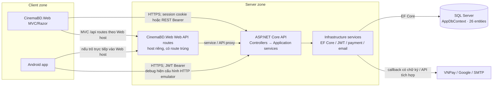

# Giai đoạn 1 — NIST CSF 1.1: IDENTIFY

## 1. Mục tiêu, phạm vi và phương pháp

Báo cáo kiểm kê tài sản số và đánh giá rủi ro bảo mật nền cho hệ thống đặt vé CinemaBD, phục vụ nội dung Chương 2 đồ án. Phạm vi gồm API ASP.NET Core .NET 8 (`CinemaBD.Api`), lớp dữ liệu EF Core (`CinemaBD.Infrastructure`), website MVC/Razor (`CinemaBD.Web`) và ứng dụng Android. Đánh giá dựa trên rà soát tĩnh mã nguồn và cấu hình trong repository; không bao gồm kiểm thử xâm nhập, kiểm tra runtime, xác minh cơ sở dữ liệu đang triển khai hay kiểm soát ở reverse proxy/cloud.

Các bảng endpoint dưới đây lấy từ controller của `CinemaBD.Api` — host API chính. `CinemaBD.Web/Controllers/Api` có các controller Web API riêng và một số route trùng; các tuyến đó được liệt kê riêng để không nhầm lẫn với API chính. Các trang MVC/Web và Android là client. `Không` ở cột xác thực nghĩa là controller/action không gắn `[Authorize]`; endpoint vẫn có thể được kiểm soát ở lớp ngoài chưa khảo sát. Các tuyến admin có policy `AdminOnly` nếu được nêu rõ.

**Tài liệu và mã nguồn đối chiếu:** `README.md`; `docs/LAYERED_ARCHITECTURE.md`; `docs/ANDROID_API_NOTES.md`; `docs/ANDROID_ADMIN_API_NOTES.md`; controller, service, cấu hình và entity được dẫn trong từng mục.

---

## 2. Kiểm kê tài sản số — NIST ID.AM

### 2.1. Thành phần và ranh giới hệ thống

| Tài sản | Thành phần / vị trí | Mục đích | Dữ liệu / mức nhạy cảm chính |
|---|---|---|---|
| Giao diện khách/admin | `CinemaBD.Web` MVC/Razor | Đăng nhập, tra cứu phim, chọn ghế, thanh toán, quản trị | Hồ sơ, session/token, dữ liệu vé và doanh thu — Internal đến Confidential |
| Ứng dụng di động | `android/` Kotlin/Jetpack Compose | Khách hàng và một số luồng quản trị gọi API | JWT, hồ sơ, lịch sử và vé — Confidential |
| API chính | `CinemaBD.Api` | Nhận HTTP, xác thực JWT, gọi nghiệp vụ | Dữ liệu công khai, tài khoản, booking, payment và admin — mọi mức |
| Nghiệp vụ / tích hợp | `CinemaBD.Application`, `CinemaBD.Infrastructure` | Service, JWT, EF Core, callback thanh toán, email, QR/PDF | Bí mật xác thực, PII và giao dịch — Confidential/Critical |
| CSDL nghiệp vụ | SQL Server qua `AppDbContext` | Lưu dữ liệu hệ thống | Tài khoản, giao dịch, vé, quyền, dữ liệu kinh doanh — Confidential/Critical |
| Nhà cung cấp ngoài | VNPay/Momo, Google, SMTP | Thanh toán, đăng nhập ngoài, gửi email | Mã giao dịch, callback, thông tin tài khoản tích hợp — Confidential |

### 2.2. Danh mục API của `CinemaBD.Api`

#### API khách hàng / công khai

| Route | HTTP | Chức năng | Xác thực hiện tại |
|---|---|---|---|
| `/api/auth/login` | POST | Đăng nhập khách hàng, phát JWT | Không |
| `/api/auth/register` | POST | Đăng ký khách hàng | Không |
| `/api/auth/google` | POST | Đăng nhập Google bằng ID token | Không |
| `/api/account/profile` | GET, PUT | Xem/cập nhật hồ sơ của người dùng hiện tại | JWT (`[Authorize]` cấp controller) |
| `/api/account/loyalty` | GET | Xem điểm thưởng của người dùng hiện tại | JWT |
| `/api/account/loyalty/preview-redeem` | POST | Tính thử quy đổi điểm | JWT |
| `/api/account/history` | GET | Lịch sử giao dịch/đặt vé của người dùng hiện tại | JWT |
| `/api/movies` | GET | Danh sách phim đang chiếu | Không |
| `/api/movies/{id}` | GET | Chi tiết phim | Không |
| `/api/movies/{id}/showtimes` | GET | Lịch chiếu phim, tùy chọn ngày | Không |
| `/api/combos` | GET | Danh sách combo | Không |
| `/api/combos/{id}` | GET | Chi tiết combo | Không |
| `/api/articles` | GET | Danh sách bài viết phân trang | Không |
| `/api/articles/{id:int}` | GET | Chi tiết bài viết | Không |
| `/api/events` | GET | Danh sách sự kiện | Không |
| `/api/bookings/showtimes/{showtimeId}/seats` | GET | Sơ đồ/trạng thái ghế của suất chiếu | Không |
| `/api/bookings/hold-seats` | POST | Giữ ghế | JWT |
| `/api/bookings/release-seats` | POST | Nhả ghế do người dùng giữ | JWT |
| `/api/bookings/checkout` | POST | Tạo giao dịch và URL thanh toán | JWT |
| `/api/bookings/refund-request` | POST | Yêu cầu hủy/hoàn tiền | JWT |
| `/api/bookings/invoice/{txnRef}` | GET | Lấy hóa đơn/vé sau thanh toán | JWT; service đối chiếu chủ sở hữu |
| `/api/payments/vnpay-return` | GET | Xử lý trình duyệt quay về từ VNPay | Không; callback được kiểm tra chữ ký tại service |
| `/api/payments/vnpay-ipn` | GET | Xử lý IPN server-to-server của VNPay | Không; callback được kiểm tra chữ ký tại service |
| `/api/payments/demo-confirm` | GET | Xác nhận thanh toán demo | Không; chỉ hoạt động trong `Development` |
| `/api/reviews/movie/{movieId}` | GET | Xem đánh giá công khai | Không |
| `/api/reviews/movie/{movieId}/eligibility` | GET | Kiểm tra điều kiện đánh giá của người dùng | JWT |
| `/api/reviews` | POST | Tạo đánh giá theo người dùng hiện tại | JWT |

#### API quản trị

Các tuyến dưới đây yêu cầu JWT với role `Admin` qua policy `AdminOnly`, ngoại trừ `/api/admin/auth/login`. Route, verb và nhóm chức năng được tổng hợp từ action attributes trong các controller quản trị.

| Route | HTTP | Chức năng | Xác thực hiện tại |
|---|---|---|---|
| `/api/admin/auth/login` | POST | Đăng nhập admin, phát token | Không |
| `/api/admin/dashboard` | GET | Số liệu tổng quan dashboard | AdminOnly |
| `/api/admin/movies` | GET, POST | Danh sách / tạo phim | AdminOnly |
| `/api/admin/movies/{id}` | GET, PUT, DELETE | Chi tiết / sửa / xóa phim | AdminOnly |
| `/api/admin/customers` | GET, POST | Danh sách / tạo khách hàng | AdminOnly |
| `/api/admin/customers/{id}` | GET, PUT, DELETE | Chi tiết / sửa / xóa khách hàng | AdminOnly |
| `/api/admin/employees` | GET, POST | Danh sách / tạo nhân viên | AdminOnly |
| `/api/admin/employees/{id:int}` | GET, PUT, DELETE | Chi tiết / sửa / xóa nhân viên | AdminOnly |
| `/api/admin/roles` | GET, POST | Danh sách / tạo vai trò | AdminOnly |
| `/api/admin/roles/{id:int}` | GET, PUT, DELETE | Chi tiết / sửa / xóa vai trò | AdminOnly |
| `/api/admin/roles/permissions` | GET | Danh sách quyền | AdminOnly |
| `/api/admin/roles/{roleId:int}/permissions` | GET | Quyền của một vai trò | AdminOnly |
| `/api/admin/roles/permissions/assign` | POST | Gán quyền cho vai trò | AdminOnly |
| `/api/admin/roles/{roleId:int}/permissions/{permissionId:int}` | DELETE | Gỡ quyền khỏi vai trò | AdminOnly |
| `/api/admin/cinemas` | GET, POST | Danh sách / thêm-cập nhật rạp | AdminOnly |
| `/api/admin/cinemas/{id}` | GET | Chi tiết rạp | AdminOnly |
| `/api/admin/cinemas/{id}/toggle` | POST | Bật/tắt trạng thái rạp | AdminOnly |
| `/api/admin/rooms` | GET, POST | Danh sách / thêm-cập nhật phòng | AdminOnly |
| `/api/admin/rooms/{id}` | GET | Chi tiết phòng | AdminOnly |
| `/api/admin/rooms/{id}/toggle` | POST | Bật/tắt trạng thái phòng | AdminOnly |
| `/api/admin/seats` | GET | Tra cứu ghế | AdminOnly |
| `/api/admin/seats/map/{roomId}` | GET | Sơ đồ ghế phòng | AdminOnly |
| `/api/admin/seats/{id}/toggle` | POST | Bật/tắt trạng thái ghế | AdminOnly |
| `/api/admin/showtimes` | GET, POST | Tra cứu / tạo suất chiếu | AdminOnly |
| `/api/admin/showtimes/{id}` | PUT, DELETE | Sửa / xóa suất chiếu | AdminOnly |
| `/api/admin/showtimes/{id}/cancel` | POST | Hủy suất chiếu | AdminOnly |
| `/api/admin/showtimes/generate` | POST | Sinh nhiều suất chiếu | AdminOnly |
| `/api/admin/showtimes/expire-passed` | POST | Đánh dấu suất chiếu đã qua | AdminOnly |
| `/api/admin/genres` | GET, POST | Danh sách / tạo thể loại | AdminOnly |
| `/api/admin/genres/{id:int}` | GET, PUT, DELETE | Chi tiết / sửa / xóa thể loại | AdminOnly |
| `/api/admin/articles` | GET, POST | Danh sách / tạo bài viết | AdminOnly |
| `/api/admin/articles/{id:int}` | GET, PUT, DELETE | Chi tiết / sửa / xóa bài viết | AdminOnly |
| `/api/admin/events` | GET, POST | Danh sách / tạo sự kiện | AdminOnly |
| `/api/admin/events/{id:int}` | GET, PUT, DELETE | Chi tiết / sửa / xóa sự kiện | AdminOnly |
| `/api/admin/combos` | GET, POST | Danh sách / tạo-cập nhật combo | AdminOnly |
| `/api/admin/combos/{id}` | GET, PUT, DELETE | Chi tiết / cập nhật / xóa combo | AdminOnly |
| `/api/admin/invoices` | GET | Danh sách hóa đơn | AdminOnly |
| `/api/admin/invoices/{id}` | GET | Chi tiết hóa đơn | AdminOnly |
| `/api/admin/invoices/sync-report` | GET | Báo cáo lệch dữ liệu hóa đơn | AdminOnly |
| `/api/admin/invoices/sync` | POST | Đồng bộ/sửa dữ liệu hóa đơn liên quan | AdminOnly |
| `/api/admin/invoices/check-in` | POST | Check-in bằng nội dung QR | AdminOnly |
| `/api/admin/loyalty-points` | GET | Tra cứu điểm thưởng | AdminOnly |
| `/api/admin/loyalty-points/{customerId}` | GET | Tra cứu điểm của khách hàng | AdminOnly |
| `/api/admin/loyalty-points/adjust` | POST | Cộng/trừ điểm thủ công | AdminOnly |
| `/api/admin/refunds` | GET | Danh sách yêu cầu hoàn tiền | AdminOnly |
| `/api/admin/refunds/{id:int}/approve` | POST | Duyệt yêu cầu hoàn tiền | AdminOnly |
| `/api/admin/refunds/{id:int}/reject` | POST | Từ chối yêu cầu hoàn tiền | AdminOnly |
| `/api/admin/statistics/revenue` | GET | Thống kê doanh thu | AdminOnly |
| `/api/admin/vouchers` | GET, POST | Tra cứu / tạo voucher | AdminOnly |
| `/api/admin/vouchers/{id}` | GET, PUT, DELETE | Chi tiết / sửa / xóa voucher | AdminOnly |
| `/api/admin/vouchers/validate` | POST | Kiểm tra điều kiện voucher | AdminOnly |

**Căn cứ route/auth:** `CinemaBD.Api/Controllers/*.cs` và `CinemaBD.Api/Controllers/Admin/*.cs`; policy `AdminOnly` đăng ký trong `CinemaBD.Api/Program.cs:70-73`. Mục lục endpoint khách và admin được đối chiếu thêm với `docs/ANDROID_API_NOTES.md:129-315` và `docs/ANDROID_ADMIN_API_NOTES.md:16-231`.

#### Các Web API riêng trong host `CinemaBD.Web`

Đây là các controller khác trong ứng dụng Web, không được gộp với host API chính. Các route trùng `/api/auth`, `/api/account`, `/api/bookings`, `/api/movies`, `/api/combos` nên cần xác định rõ host/port khi triển khai.

| Route | HTTP | Chức năng | Kiểm soát ghi nhận trong controller |
|---|---|---|---|
| `/api/auth/login`, `/api/auth/register` | POST | Đăng nhập / đăng ký qua `IAuthCoreService` | Không có `[Authorize]` |
| `/api/account/profile`, `/api/account/history` | GET | Đọc hồ sơ / lịch sử | Tự lấy token; nếu thiếu token trả 401; có fallback header `X-User-Id` |
| `/api/bookings/showtimes/{showtimeId}/seats` | GET | Sơ đồ ghế | Không có `[Authorize]` |
| `/api/bookings/checkout` | POST | Checkout qua service lõi | Lấy Bearer token, nhưng nếu thiếu Bearer chấp nhận header `X-User-Id` |
| `/api/bookings/invoice/{txnRef}` | GET | Đọc hóa đơn | Gọi service theo `txnRef`; controller không đòi token |
| `/api/movies`, `/api/movies/{id}`, `/api/movies/{id}/showtimes` | GET | Danh sách, chi tiết, lịch chiếu | Không có `[Authorize]` |
| `/api/combos` | GET | Danh sách combo | Không có `[Authorize]` |

Nguồn: `CinemaBD.Web/Controllers/Api/AuthApiController.cs:6-35`, `AccountApiController.cs:6-49`, `BookingsApiController.cs:6-55`, `MoviesApiController.cs:6-40`, `CombosApiController.cs:6-22`. Endpoint Web invoice dùng service trung gian; phạm vi kiểm tra quyền phía service cần xác minh riêng. Việc dùng `X-User-Id` như giá trị token là điểm đáng chú ý, không mặc định là user ID hợp lệ hay xác thực an toàn.

### 2.3. Entity / mô hình dữ liệu trong `AppDbContext`

`CinemaBD.Infrastructure/Persistence/AppDbContext.cs:38-64` khai báo **26 DbSet/entity**. Phân loại dưới đây dựa trên loại trường và mục đích nghiệp vụ; `Critical` biểu thị ảnh hưởng lớn tới tính bí mật/toàn vẹn, không phải phân loại dữ liệu pháp lý chính thức.

| DbSet / Entity | Phân loại | Dữ liệu điển hình và lý do |
|---|---|---|
| `Movies` / `LegacyMovie` | Public | Tiêu đề, thể loại, mô tả, poster, trailer, lịch phát hành. |
| `Cinemas` / `LegacyCinema` | Public / Internal | Tên, địa chỉ và số điện thoại rạp; thông tin liên hệ doanh nghiệp. |
| `Rooms` / `LegacyRoom` | Internal | Tên, số lượng ghế, trạng thái và mã rạp. |
| `Seats` / `LegacySeat` | Internal | Mã ghế/phòng, loại ghế, trạng thái. |
| `Showtimes` / `LegacyShowtime` | Internal | Phim, phòng, ngày giờ, giá vé, trạng thái vận hành. |
| `Tickets` / `LegacyTicket` | Confidential | Mã vé, khách hàng, ghế, giao dịch, giá và trạng thái check-in. |
| `Payments` / `LegacyPayment` | Confidential / Critical | Số tiền, trạng thái và tham chiếu/metadata thanh toán; không nên chứa dữ liệu thẻ đầy đủ. |
| `Combos` / `LegacyCombo` | Public | Tên, giá, mô tả và ảnh combo. |
| `BookedCombos` / `LegacyBookedCombo` | Confidential | Số lượng, giá và tham chiếu giao dịch đã mua. |
| `Customers` / `LegacyCustomer` | Confidential / Critical | Họ tên, điện thoại, email, username, ngày sinh và trường mật khẩu. |
| `Admins` / `LegacyAdmin` | Confidential / Critical | Tài khoản, trường mật khẩu, thông tin liên hệ và vai trò admin. |
| `Roles` / `LegacyRole` | Internal / Critical | Vai trò, trạng thái và quyền quản trị. |
| `Permissions` / `LegacyPermission` | Internal / Critical | Danh mục quyền truy cập. |
| `RolePermissions` / `LegacyRolePermission` | Internal / Critical | Liên kết vai trò-quyền, ảnh hưởng authorization. |
| `Employees` / `LegacyEmployee` | Confidential | Họ tên, ngày sinh, điện thoại, email, chức vụ/trạng thái. |
| `Genres` / `LegacyGenre` | Public | Tên và mô tả thể loại. |
| `Articles` / `LegacyArticle` | Public / Internal | Nội dung, hình ảnh và thời điểm đăng; nội dung nháp/quản trị có thể là Internal. |
| `Events` / `LegacyEvent` | Public / Internal | Nội dung và khoảng thời gian sự kiện. |
| `Reviews` / `LegacyReview` | Internal / Confidential | Nội dung do khách tạo, ID khách, rating/trạng thái ẩn và thời gian. |
| `Invoices` / `LegacyInvoice` | Confidential / Critical | Khách hàng, tổng tiền, giao dịch, trạng thái, ngày thanh toán. |
| `InvoiceLineItems` / `LegacyInvoiceLineItem` | Confidential | Chi tiết vé/combo, số lượng, đơn giá và hóa đơn liên kết. |
| `InvoiceHistories` / `LegacyInvoiceHistory` | Confidential | Lịch sử trạng thái và ghi chú hóa đơn. |
| `Vouchers` / `LegacyVoucher` | Confidential | Mã khuyến mại, khách sở hữu, điều kiện, giá trị và trạng thái sử dụng. |
| `LoyaltyPoints` / `LegacyLoyaltyPoints` | Confidential | Điểm tích lũy/điều chỉnh gắn với khách hàng. |
| `RefundRequests` / `LegacyRefundRequest` | Confidential / Critical | Khách, vé/hóa đơn, lý do, số tiền hoàn, quyết định và ghi chú admin. |

**Căn cứ cấu trúc:** `CinemaBD.Infrastructure/Persistence/AppDbContext.cs:38-64`; entity nghiệp vụ phim/vé/thanh toán ở `LegacyEntities.cs:6-133`, khách hàng ở `LegacyUserEntities.cs:5-16`, admin ở `LegacyAdminEntities.cs:5-19`, vai trò/nhân viên ở `LegacyOrganizationEntities.cs:5-46`, nội dung/hóa đơn/voucher/điểm/refund ở `LegacyContentEntities.cs:6-144`. Tên cột `MatKhau`/`Password` là trường lưu mật khẩu/credential; không khẳng định tại đây mọi giá trị đều plaintext, vì cần kiểm tra dữ liệu thực tế và đường migration.

### 2.4. Sơ đồ luồng dữ liệu

Sơ đồ thể hiện các tuyến triển khai/luồng đã rà soát; không phải mọi màn hình Web đều chắc chắn đi qua cùng host API. Cấu hình HTTPS redirect của API ở `CinemaBD.Api/Program.cs:103-106`; cấu hình Android ở `android/app/build.gradle.kts:27-38` và `AndroidManifest.xml:7-17`.

---

## 3. Đánh giá lỗ hổng mã nguồn ban đầu — NIST ID.RA

### 3.1. Cách diễn giải

Đánh giá áp dụng OWASP API Security Top 10 (2023) và STRIDE như lăng kính phân loại rủi ro, không phải kết luận chứng nhận tuân thủ. Mỗi dòng dưới đây ghi rõ trạng thái: **Xác nhận trong mã** là kiểm soát thiếu hoặc hành vi quan sát được; **Rủi ro/cần xác minh** là giả thuyết cần kiểm thử cấu hình/schema/runtime trước khi gọi là lỗ hổng khai thác được. Các tham chiếu `tệp:dòng` là nguồn bằng chứng.

### 3.2. Phát hiện và điểm cần xác minh

| ID / Tên | OWASP API / STRIDE | Bằng chứng mã nguồn và đánh giá | Tài sản / tác động | Khuyến nghị |
|---|---|---|---|---|
| F-02 — Kênh HTTP được cho phép trong cấu hình Android | API2:2023 Broken Authentication; Eavesdropping / Tampering | **Xác nhận:** `android/app/src/main/AndroidManifest.xml:7-17` đặt `usesCleartextTraffic="true"`; `android/app/build.gradle.kts:27-34` cấu hình debug `http://10.0.2.2:5067/`, trong khi release dùng placeholder HTTPS. Nếu build debug trao đổi JWT/thông tin đăng nhập qua mạng không tin cậy thì lưu lượng có thể bị nghe lén/chỉnh sửa; không phải bằng chứng release đang gọi HTTP. | Token JWT, đăng nhập và giao dịch trong môi trường debug. | Tắt cleartext cho bản phát hành; chỉ cho HTTP trong cấu hình debug/mạng emulator phù hợp; xác minh cấu hình APK release. |
| F-03 — JWT lưu ở Preferences DataStore, không thấy mã hóa tại tầng sử dụng | API2:2023 Broken Authentication; Information Disclosure | **Xác nhận giới hạn mã nguồn:** `TokenDataStore.kt:21-35,52-64` lưu chuỗi `jwt_token` trong Preferences DataStore, không thấy lớp mã hóa ở đây. Backup exclusion có trong `backup_rules.xml:5-8` và `data_extraction_rules.xml:5-14`; chưa xác minh khả năng trích xuất trên thiết bị/root/runtime. | JWT có quyền truy cập tài khoản/đặt vé. | Dùng Android Keystore/giải pháp lưu trữ bảo mật phù hợp; hạn chế thời hạn token, xóa khi logout/401; kiểm thử trên thiết bị. |
| F-04 — QR check-in không có chữ ký mật mã riêng | API3:2023 Broken Object Property Level Authorization / Integrity; Tampering, Spoofing | **Xác nhận:** QR tạo payload dạng `CinemaBD|CHECKIN|...` chỉ gồm mã giao dịch/hóa đơn/vé tại `CinemaBD.Web/Controllers/BookingController.cs:422-444`; parser nhận các ID tại `CinemaBD.Infrastructure/Services/MissingAdminServices2.cs:341-367`. Check-in còn kiểm tra hóa đơn đã thanh toán và trạng thái vé tại `MissingAdminServices2.cs:137-176`; QR thiếu HMAC tự nó chưa chứng minh có thể giả mạo check-in hợp lệ. | Vé điện tử, check-in và kiểm soát vào rạp. | Ký payload QR (HMAC/ký số có key quản lý an toàn), ràng buộc ticket/txn, thời hạn hoặc nonce; kiểm tra chống replay đồng thời; giữ xác thực admin. |
| F-05 — Có endpoint xác nhận thanh toán demo không yêu cầu đăng nhập trong Development | API2:2023 Broken Authentication; Spoofing / Tampering | **Xác nhận có điều kiện môi trường:** `PaymentsController.cs:41-49` chỉ kiểm tra `IsDevelopment()` và không có `[Authorize]`; `PaymentService.cs:48-49,101-114` xử lý xác nhận để cập nhật trạng thái thanh toán/vé và hóa đơn. Rủi ro lớn nếu vô tình chạy cấu hình Development có thể truy cập từ mạng ngoài. | Tính toàn vẹn thanh toán, vé và hóa đơn. | Không triển khai Development ra môi trường truy cập công khai; thêm guard cấu hình/host và kiểm thử pipeline deployment. |
| F-06 — Các Web API tuyến hóa đơn/identity có đường xác thực yếu cần xác minh | API1:2023 Broken Object Level Authorization; Spoofing / Elevation | **Rủi ro cần xác minh:** `CinemaBD.Web/Controllers/Api/BookingsApiController.cs:38-46` truy xuất invoice bằng `txnRef` mà controller không bắt buộc JWT; `AccountApiController.cs:17-39` kiểm tra token tồn tại nhưng controller không có `[Authorize]`; helper nhận fallback `X-User-Id` ở `AccountApiController.cs:42-49` và `BookingsApiController.cs:48-55`. Service phía sau có thể xác thực/ủy quyền token; chưa kiểm chứng đủ nội dung toàn bộ service và cấu hình host nên chưa kết luận BOLA. | Hồ sơ, lịch sử, hóa đơn và vé cá nhân; lộ mã giao dịch có thể ảnh hưởng riêng tư nếu service không ràng buộc chủ sở hữu. | Xác minh service và endpoint Web host; dùng middleware JWT chuẩn, derive user từ claim đã xác minh thay vì header định danh tự khai báo; ràng buộc owner cho mọi truy vấn hóa đơn. |
| F-07 — Admin authorization dựa trên role chung `Admin` | API5:2023 Broken Function Level Authorization; Elevation | API chính đăng ký `AdminOnly` bằng `RequireRole("Admin")` tại `CinemaBD.Api/Program.cs:70-73`; các controller admin được gắn policy tại controller scope, ví dụ `AdminInvoicesController.cs:7-8`, `AdminVouchersController.cs:7-9`, `AdminArticlesController.cs:6-8`. Đây là kiểm soát hiện có; chưa thấy phân quyền chi tiết theo permission cho từng chức năng trong policy startup. | Hóa đơn, tài khoản, vai trò, hoàn tiền, cấu hình vận hành. | Duy trì kiểm thử phủ route; nếu cần phân tách quyền nhân viên/admin, ánh xạ permission cụ thể và audit thay đổi nhạy cảm. |
| F-08 — BOLA trong API chính chưa được xác nhận; giữ nguyên các xác minh quyền hiện có | API1:2023 Broken Object Level Authorization; Elevation | Các API account và hành động booking lấy `userId` từ claim tại `AccountController.cs:10-13`, `BookingsController.cs:34-42,46-55,58-80,84-94`. `GetInvoiceAsync` lọc `tickets` theo `userId` khi không phải admin tại `BookingService.cs:437-465`. Các điểm kiểm soát này chống trường hợp đổi `txnRef` đơn giản; cần kiểm thử end-to-end mọi nhánh và những API Web riêng. | Hồ sơ, lịch sử, giữ ghế, yêu cầu hoàn tiền và hóa đơn. | Thêm test âm tính với user A đọc/cập nhật/hủy tài nguyên user B; không xem việc dùng ID khó đoán là kiểm soát thay authorization. |
| F-09 — Race condition giữ ghế: đã có transaction nhưng cần kiểm chứng ở SQL/schema triển khai | API6:2023 Unrestricted Access to Sensitive Business Flows; Tampering / DoS | `BookingService.cs:36-57,65-90` dùng transaction `Serializable`, kiểm tra ghế Paid và Pending của user khác; checkout cũng dùng `Serializable` tại `BookingService.cs:123-147`. `AppDbContext.cs:14-35` chỉ khai báo unique index giao dịch hóa đơn và key ghế theo phòng+mã ghế, không khai báo unique constraint ticket theo suất chiếu+ghế hoặc concurrency token. Không kết luận race khai thác được nếu không xác minh isolation/schema thực tế và xử lý serialization failure/retry. | Tính độc nhất của suất chiếu-ghế, thu tiền/hoàn tiền. | Kiểm tra migration/schema production; xem xét constraint phù hợp và retry xung đột có kiểm soát; chạy kiểm thử đồng thời nhiều request. |
| F-10 — Voucher có luồng trạng thái giữa checkout và xác nhận thanh toán | API6:2023 Unrestricted Access to Sensitive Business Flows; Tampering | Checkout tính voucher ở `BookingService.cs:281-307`, ghi dấu voucher khách hàng đã dùng trước khi giao dịch thanh toán hoàn tất ở `BookingService.cs:218-232`, còn luồng hết hạn gọi mở lại voucher ở `BookingService.cs:323-356`. **Rủi ro/cần xác minh:** giao dịch serializable hỗ trợ một phần, nhưng còn cần kiểm thử interleaving callback/expiry/retry và voucher toàn cục; entity không thể hiện concurrency token (`LegacyContentEntities.cs:98-115`). | Giá trị khuyến mại, điểm thưởng, doanh thu. | Kiểm thử nhiều checkout cùng mã, callback trùng/thất bại và job hết hạn; cân nhắc idempotency, trạng thái giữ voucher có thời hạn và ràng buộc DB. |
| F-11 — `X-Return-Url` được nhận từ request checkout | API10:2023 Unsafe Consumption of APIs / Unvalidated Redirects; Tampering | `BookingsController.cs:66-69` chuyển header `X-Return-Url` vào service; `VnPayUrlBuilder.cs:16-41` dùng nó làm return URL trong thông tin thanh toán ký. Chưa thấy allowlist trong đường đi này; tác động phụ thuộc chính sách VNPay có chấp nhận return URL do merchant gửi hay không. | Luồng thanh toán và niềm tin người dùng khi trở về từ gateway. | Chỉ chấp nhận URL cố định/allowlist origin do máy chủ cấu hình; bỏ qua URL tùy ý do client cung cấp. |
| F-12 — Cấu hình có placeholder, không phải bằng chứng lộ secret thật | API2:2023 Broken Authentication; Information Disclosure | `CinemaBD.Api/appsettings.json:1-37` chứa connection string local và placeholder cho JWT/VNPay/SMTP/Google. `Program.cs:47-49` từ chối thiếu JWT key hoặc key có tiền tố `CHANGE_ME`. **Không xác nhận secret thực bị commit.** Cần xác minh môi trường deploy có override bằng secret manager và không dùng placeholder cho VNPay/SMTP. `AllowedHosts: "*"` (`appsettings.json:37`) không đồng nghĩa với CORS mở. | Bí mật xác thực, DB và tích hợp ngoài. | Tiếp tục inject secret qua môi trường/secret store; rà soát lịch sử Git và secret scanning; không ghi giá trị thật vào tài liệu. |
| F-13 — CORS không được đăng ký trong API startup | API8:2023 Security Misconfiguration; Spoofing | **Xác nhận:** không có `AddCors`/`UseCors` trong `CinemaBD.Api/Program.cs:8-108`. CORS không phải cơ chế xác thực; việc không cấu hình không chứng minh lỗ hổng trên Android/native app. Cần xác minh khi API được gọi bởi browser SPA hoặc WebView từ origin khác. | Browser client, session/token khi vận hành qua web. | Nếu cần cross-origin, chỉ allowlist origin/method/header bắt buộc; không dùng `AllowAnyOrigin` kết hợp credential. |
| F-14 — Endpoint đăng nhập chưa thấy rate limiting trong API | API4:2023 Unrestricted Resource Consumption; Spoofing | Không có rate limiter tại `Program.cs:8-108`; `AuthController.cs:19-52` công khai login/register/Google login. Đây là xác nhận thiếu giới hạn ở pipeline được đọc, chưa xác minh WAF ngoài. | Mật khẩu/tài khoản và tính sẵn sàng dịch vụ. | Rate limit theo IP và tài khoản, hạn chế credential stuffing; trả lỗi không tiết lộ quá mức và cảnh báo bất thường. |
| F-15 — Kiểm tra chữ ký callback thanh toán là kiểm soát đang có | API2:2023 Broken Authentication / Integrity; Tampering | Callback không `[Authorize]` tại `PaymentsController.cs:20-39` là phù hợp với server-to-server gateway, nhưng `PaymentService.cs:140-154` xác minh chữ ký VNPay và số tiền trước cập nhật trạng thái. Không phát hiện signature bypass từ rà soát tĩnh này. | Tính toàn vẹn thanh toán và trạng thái vé. | Giữ xác minh chữ ký/số tiền, chống xử lý callback lặp, và kiểm thử chữ ký sai/amount mismatch. |
| F-16 — Mật khẩu tương thích legacy MD5/plaintext cần ưu tiên loại bỏ | API2:2023 Broken Authentication; Information Disclosure | `CinemaBD.Infrastructure/Security/Md5PasswordHasher.cs:16-32` còn xác minh giá trị legacy MD5 và plaintext, trong khi mã hóa mới dùng ASP.NET Identity hasher (`:10-14`). Cần xác minh có tài khoản thực nào còn dùng định dạng cũ; nếu có, ảnh hưởng cao khi database bị lộ. | Tài khoản khách/admin và khả năng chiếm quyền. | Bắt buộc reset/migrate định dạng yếu, không tiếp tục chấp nhận plaintext/MD5, kiểm tra dữ liệu lịch sử theo quy trình bảo vệ riêng tư. |

### 3.3. Gắn phát hiện với STRIDE

| STRIDE | Ví dụ phát hiện trong phạm vi khảo sát |
|---|---|
| **S — Spoofing (giả mạo)** | F-02 lưu lượng HTTP debug; F-05 demo-confirm công khai ở Development; F-14 thiếu giới hạn thử đăng nhập. |
| **T — Tampering (sửa đổi)** | F-04 QR chưa ký; F-09/F-10 tính toàn vẹn booking/voucher khi đồng thời; F-11 return URL từ client. |
| **R — Repudiation (chối bỏ)** | Thay đổi check-in/refund/điểm cần audit log người thực hiện, thời điểm và kết quả; phạm vi rà soát không xác nhận đầy đủ audit trail tập trung. |
| **I — Information Disclosure (lộ thông tin)** | F-03 JWT lưu trữ; F-06 API Web invoice/profile cần xác minh; F-12 kiểm soát secret cấu hình. |
| **D — Denial of Service (từ chối dịch vụ)** | F-01/F-14 chưa thấy rate limiting trong startup; các endpoint public cần giới hạn tải. |
| **E — Elevation of Privilege (nâng quyền)** | F-07 cần xem xét granular permissions; F-06 cần kiểm chứng identity claim và ownership tại host Web API. |

---

## 4. Ma trận đánh giá rủi ro

### 4.1. Tiêu chí

- **Likelihood (L):** High nếu tuyến khai thác dễ truy cập/tác động trực tiếp từ client; Medium nếu cần điều kiện môi trường, truy cập hợp lệ hoặc chuỗi sự kiện; Low nếu chỉ còn khả năng lý thuyết sau khi các kiểm soát hiện hữu hoạt động.
- **Impact (I):** High nếu có thể ảnh hưởng tài khoản, tiền, quyền quản trị hoặc vé; Medium nếu chủ yếu là lộ dữ liệu hạn chế/gián đoạn chức năng; Low nếu tác động nhỏ và phạm vi hẹp.
- **Mức rủi ro tổng hợp:** High khi L và I đều High hoặc một High và còn lại Medium; Medium khi một yếu tố Medium và yếu tố còn lại Low/Medium; Low khi cả hai Low. Điểm cho rủi ro cần xác minh có tính bảo thủ và phải cập nhật sau kiểm thử.

### 4.2. Bảng xếp hạng

| ID | Rủi ro | Likelihood | Impact | Mức | Ghi chú |
|---|---|---:|---:|---|---|
| F-16 | Tài khoản legacy dùng MD5/plaintext nếu còn tồn tại | Medium | High | High | Cần xác minh dữ liệu thực; password hash yếu có thể dẫn đến takeover sau DB leak. |
| F-05 | Demo payment confirm có thể truy cập nếu môi trường Development lộ ra ngoài | Medium | High | High | Mức rủi ro tùy cấu hình deployment; chức năng có thể đổi trạng thái giao dịch/vé. |
| F-06 | BOLA tiềm ẩn ở Web API profile/invoice | Medium | High | High | Chưa kết luận vì chưa kiểm chứng toàn bộ service/host; ưu tiên kiểm thử quyền truy cập chéo user. |
| F-04 | QR payload không có chữ ký | Medium | High | High | Kiểm tra thanh toán/check-in giảm tác động; cần kiểm thử giả mạo/replay và cơ chế bảo vệ admin. |
| F-02 | HTTP debug/cleartext có thể làm lộ token | Medium | High | High | Chỉ áp dụng khi build debug chạy qua mạng không tin cậy; release URL hiện là HTTPS placeholder. |
| F-09 | Cạnh tranh ghế nếu schema/isolation thực tế không bảo đảm | Low | High | Medium | Transaction Serializable đã có; cần test SQL Server/schema và xử lý deadlock/serialization. |
| F-10 | Tái sử dụng/hoàn trạng thái voucher sai khi callback đồng thời | Low | High | Medium | Có trạng thái và quy trình reopen; cần thử đồng thời, idempotency callback và global voucher. |
| F-03 | JWT có thể bị truy xuất từ vùng lưu trữ ứng dụng | Low | High | Medium | App sandbox và backup exclusions là giảm thiểu; tầng code không thể hiện encryption. |
| F-11 | Return URL checkout do client truyền | Medium | Medium | Medium | Cổng thanh toán có thể từ chối return URL không phù hợp; cần allowlist. |
| F-14 | Brute force/credential stuffing do chưa thấy rate limit | Medium | Medium | Medium | Có thể có WAF bên ngoài chưa khảo sát; xác nhận thiếu ở API startup. |
| F-01 | Abuse/tiêu thụ tài nguyên API public | Medium | Medium | Medium | Tác động phụ thuộc tải và lớp bảo vệ ngoài; bổ sung giới hạn ở các tuyến phù hợp. |
| F-12 | Secret cấu hình nếu môi trường production dùng placeholder/sai override | Low | High | Medium | Không thấy credential thật đã lộ; cần xác minh deployment và secret store. |
| F-13 | CORS nếu browser cross-origin cần gọi API | Low | Medium | Low | Không cấu hình không tạo lỗ hổng trực tiếp cho client Android native. |
| F-07 | Role Admin chung chưa thể hiện phân quyền theo chức năng | Low | High | Medium | Policy role hiện có; cần xác định mô hình phân quyền nghiệp vụ và kiểm thử route. |
| F-15 | Callback giả mạo VNPay | Low | High | Low | Chữ ký và số tiền đã được xác minh trong service; tiếp tục test callback lặp/sai chữ ký. |
| F-08 | IDOR/BOLA tại API chính | Low | High | Low | Owner check theo user claim đã thấy; cần regression tests, đặc biệt nhánh Web API riêng. |

**Ưu tiên xử lý đề xuất:** (1) xác minh bằng test deployment rằng endpoint demo chỉ tồn tại trong môi trường phát triển và Web API không thể đọc invoice chéo user; (2) kiểm tra danh tính Android qua HTTP có dùng dữ liệu thật không, chuyển token sang lưu trữ bảo vệ bằng Keystore; (3) loại bỏ mật khẩu legacy yếu và ký số payload QR; (4) bổ sung rate limiting, allowlist return URL và test concurrency cho ghế/voucher; (5) rà soát secrets/configuration trong pipeline triển khai.

---

## 5. Kết luận và giới hạn

Kiểm kê cho thấy CinemaBD có 26 entity trong `AppDbContext`, các nhóm dữ liệu trải từ nội dung công khai đến PII, thông tin tài khoản, payment, vé và quyền quản trị. API chính có xác thực JWT và policy `AdminOnly`; booking/invoice chính có kiểm tra quyền sở hữu, giao dịch ghế/checkout dùng isolation `Serializable`, callback VNPay kiểm tra chữ ký và số tiền. Những kiểm soát này không nên bị mô tả là vắng mặt.

Các ưu tiên baseline là kiểm tra triển khai Development/demo payment, xác minh riêng Web API host có overlap route và các đường đọc hóa đơn, giảm khả năng lộ JWT trên Android/debug, tăng khả năng chống brute-force, kiểm thử transaction/callback voucher và bổ sung chữ ký cho QR. Rà soát tĩnh không chứng minh được khả năng khai thác, hành vi schema thật hoặc controls từ hạ tầng bên ngoài. Cần bổ sung kiểm thử động, kiểm tra cấu hình production, test phân quyền chéo tài khoản và xác minh audit/backup trước khi xác nhận mức rủi ro cuối cùng.

### Tài liệu nguồn chính

- `CinemaBD.Api/Program.cs`
- `CinemaBD.Api/Controllers/` và `CinemaBD.Api/Controllers/Admin/`
- `CinemaBD.Infrastructure/Services/BookingService.cs`, `PaymentService.cs`, `MissingAdminServices2.cs`
- `CinemaBD.Infrastructure/Persistence/AppDbContext.cs` và các `Legacy*Entities.cs`
- `CinemaBD.Api/appsettings.json` (chỉ xác định cấu trúc/placeholder; không sao chép secret)
- `android/app/src/main/AndroidManifest.xml`, `android/app/build.gradle.kts`, `android/app/src/main/java/com/cinemabd/app/core/datastore/TokenDataStore.kt`
- `docs/ANDROID_API_NOTES.md`, `docs/ANDROID_ADMIN_API_NOTES.md`, `docs/LAYERED_ARCHITECTURE.md`
